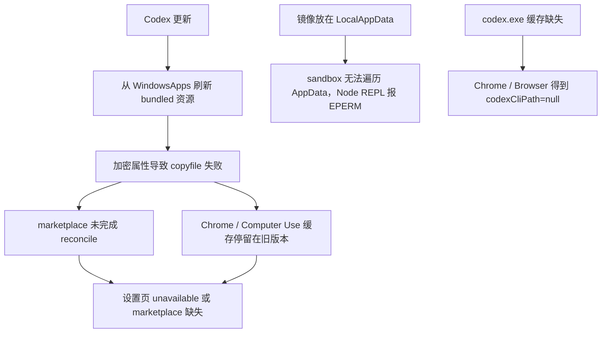

<!-- Generated by scripts/sync-obsidian-notes.mjs from Obsidian Publish. Do not edit by hand. -->

## Codex Desktop bundled 插件故障排查与修复

### 事件摘要

| 项目 | 内容 |
|---|---|
| 环境 | Windows、Microsoft Store 版 Codex Desktop |
| 影响 | Computer Use、Chrome 及 bundled marketplace 无法稳定加载 |
| 触发 | Codex 更新后 bundled 资源发生半更新 |
| 当时判断的主因 | `WindowsApps` 中的 bundled 资源带有加密属性，Codex 原生复制到 staging 时失败 |
| 次生阻塞 | 旧插件缓存、缺失的 CLI 可执行文件缓存，以及隔离环境无法遍历 `$env:LOCALAPPDATA` 镜像 |
| 最终处理 | 将未加密资源镜像迁移到 `$env:USERPROFILE\.codex`，设置 bundled 专用覆盖变量，并补齐匹配版本缓存 |
| 会话结果 | Computer Use 与 Google Chrome 扩展均完成真实连接验证 |

> **Warning: 证据边界**
> 本文由 2026-07-13 的 Codex 排障会话结晶而成，本文整理时没有重新执行系统级诊断。下文的版本、日志和能力验证结果均是对原会话记录的转述；问题复发时必须重新采集当次证据。

### 用户可见症状

- Codex 更新后，Computer Use 或 Chrome 插件消失、图标不加载或显示不可用。
- 插件页仍能看见 `computer-use@openai-bundled`、`chrome@openai-bundled`，进入后却提示 bundled marketplace 文件不存在。
- 设置页中的 Computer Use 显示 `unavailable`。
- 日志可能出现 `copyfile`、`EBUSY`、`resource busy or locked`、`plugin_cache_windows_file_lock`、`os error 5`、`codexCliPath=null` 或 `extension-host.exe` 等关键词。
- 应用包内插件已经更新，但 `$env:USERPROFILE\.codex\plugins\cache\openai-bundled` 仍保留旧版本。

### 故障链



#### 主根因：`WindowsApps` 源文件复制失败

本次启动日志显示，Codex 从 `WindowsApps` 复制 bundled 资源到随机 staging 目录时，在 `plugins\sites\.app.json` 等文件处发生 `copyfile` 错误。手工重建用户缓存只能暂时补齐文件，因为下次启动仍会重复同一失败流程。

将同一批资源复制为未加密镜像，并让 Codex 从镜像刷新后，日志转为 `plugin_marketplace_folder_write_succeeded`，bundled marketplace 也完成注册。这一前后对照是主根因的核心证据。

#### 次生问题

| 问题 | 表现 | 处理 |
|---|---|---|
| 插件缓存半更新 | Chrome 与 Computer Use 缓存版本落后于应用包 | 重建版本目录和 `latest` junction |
| 镜像位置不可访问 | Node REPL 报 `EPERM lstat ...\AppData` | 将镜像从 `$env:LOCALAPPDATA` 迁移到 `$env:USERPROFILE\.codex` |
| CLI 缓存缺失 | `codexCliPath=null` | 补齐 Codex CLI 与 ripgrep 的哈希缓存 |
| Chrome 检测误报 | 文件检查提示扩展不存在，但真实连接成功 | 以扩展连接测试为准，不以配置目录探测结果定论 |

### 修复过程

#### 阶段 1：只读诊断

修复前记录以下状态：

- Codex 进程启动时间和实际安装包版本；
- bundled marketplace 文件是否存在；
- Chrome、Computer Use 的缓存版本及 `latest` 目标；
- `scripts`、`extension-host\windows\x64\extension-host.exe` 是否齐全；
- 最新启动日志中 marketplace、native pipe、Node REPL 和 CLI 路径相关错误。

历史日志中的通用 `unavailable` 或 `EBUSY` 不能单独证明当前故障。应限定到本次进程启动时间之后，再判断错误是否仍在发生。

#### 阶段 2：备份

所有路径使用环境变量构造，避免绑定具体用户名：

```powershell
$CodexHome = Join-Path $env:USERPROFILE '.codex'
$BackupRoot = Join-Path $env:USERPROFILE 'codex-plugin-backups'
$OpenAILocal = Join-Path $env:LOCALAPPDATA 'OpenAI'
$CodexLocal = Join-Path $OpenAILocal 'Codex'
```

备份至少包含以下存在的文件：

- `$CodexHome\config.toml`
- `$CodexHome\.codex-global-state.json`
- Codex 与 Chrome native-host JSON
- `$env:LOCALAPPDATA\OpenAI\extension\com.openai.codexextension.json`
- 修改前的用户级环境变量值

#### 阶段 3：恢复 marketplace 与插件缓存

停止 `extension-host` 和 `codex-computer-use` 后，从当前 Codex 安装包的官方资源重建：

- `$CodexHome\.tmp\bundled-marketplaces\openai-bundled`
- `$CodexHome\plugins\cache\openai-bundled\chrome`
- `$CodexHome\plugins\cache\openai-bundled\computer-use`
- 两个插件的 `latest` junction

此阶段用于消除已经形成的半更新状态，但不能单独解决启动时再次从 `WindowsApps` 复制失败的问题。

#### 阶段 4：部署持久的未加密资源镜像

最终镜像位于：

```text
$env:USERPROFILE\.codex\runtimes\bundled-resources\<timestamp>
```

镜像包含 bundled plugins、`cua_node`、`codex.exe` 和 `rg.exe`。部署时需要满足：

- 使用流式复制，避免继承 Store 文件的 `Encrypted` 属性；
- 使用 `\\?\` 扩展路径格式处理 `cua_node` 深层依赖；
- 完成后确认必需文件存在，且加密文件数为 0；
- 不把最终运行时放在当前 sandbox 无法遍历的 `$env:LOCALAPPDATA` 路径。

随后设置用户级专用变量：

```text
CODEX_ELECTRON_BUNDLED_PLUGINS_RESOURCES_PATH=<镜像绝对路径>
```

该变量直接服务于 bundled 插件资源流程。通用的 `CODEX_ELECTRON_RESOURCES_PATH` 不等价，不应作为替代方案。

#### 阶段 5：补齐可执行文件缓存

marketplace 恢复后，Chrome/Browser 仍可能因 `codex.exe` 的独立复制路径失败而得到 `codexCliPath=null`。本次会话继续补建了 Codex CLI 和 ripgrep 的预期哈希缓存，并在下一次启动日志中确认路径缺失消失。

#### 阶段 6：完全重启

用户级环境变量只会被新进程读取。必须退出 Codex 主窗口和系统托盘进程后重新打开；仅关闭窗口不足以完成验证。

### 验收标准

修复必须同时通过三个层级，不能只看设置页或文件是否存在。

#### 文件层

- [ ] bundled marketplace 文件存在且可解析。
- [ ] Chrome 与 Computer Use 缓存版本和当前应用包一致。
- [ ] `latest` junction 指向实际版本目录，而不是 `.tmp`。
- [ ] Chrome 的 `extension-host.exe` 和 Computer Use 脚本齐全。
- [ ] 资源镜像所需文件完整，且没有 `Encrypted` 属性。

#### 日志层

- [ ] 新启动日志使用 `$env:USERPROFILE\.codex` 下的资源镜像。
- [ ] 出现 marketplace 写入和注册成功记录。
- [ ] 不再出现本次启动产生的 `WindowsApps` `copyfile` 错误。
- [ ] 不再出现 `codexCliPath=null`。
- [ ] Computer Use native pipe 出现 `startup ready`。
- [ ] Node REPL 启动时不再出现镜像路径相关 `EPERM`。

#### 能力层

- [ ] Computer Use 能真实连接 Windows 并枚举应用。
- [ ] Chrome 插件能连接已安装的 Google Chrome 扩展。
- [ ] 能以只读方式取得标签页信息。

原会话最终记录：Computer Use 枚举到 40 个 Windows 应用；Google Chrome 扩展连接成功，并只读识别到 1 个标签页。这些数字只代表当时环境，不是固定验收阈值。

### 复发时的最小处置顺序

1. 记录进程启动时间、应用包版本、缓存版本、`latest` 目标和最新日志，暂不删除文件。
2. 判断是当前启动错误，还是历史日志噪声。
3. 比较应用包、资源镜像和插件缓存版本，确认是否因 Codex 更新而失配。
4. 检查专用环境变量是否仍指向存在、完整、未加密且 sandbox 可访问的镜像。
5. 备份后重建当前版本的镜像、marketplace、插件缓存和必要的可执行文件缓存。
6. 完全重启 Codex，依次执行文件层、日志层和能力层验收。

> **Important: 更新后的维护要求**
> 资源镜像不是一次性永久修复。Codex 更新后，如果应用包中的 bundled 版本发生变化，应重新生成匹配版本的镜像；不要继续复用旧镜像并仅调整 `latest` 指针。

### 禁止与注意事项

- 不要在诊断开始时直接删除 `.codex`、插件缓存或全局状态文件。
- 不要因为出现 `EPERM` 或 `unavailable` 就盲目修改 `[windows] sandbox`；本次修复没有改动 sandbox。
- 不要手工伪造 Chrome native-host manifest 或注册表项，应由正常插件安装流程生成。
- 不要用通用 `CODEX_ELECTRON_RESOURCES_PATH` 替代 bundled 专用变量。
- 不要将配置目录探测失败等同于 Chrome 扩展未安装，应尝试真实连接。
- 不要在报告、脚本或日志摘录中暴露 token、API key 或其他凭据。

### 来源与相关笔记

- 来源：用户提供的 Codex 会话「修复 computer-use 插件」（2026-07-13），包含逐阶段诊断、修复脚本摘要、多次重启日志和最终能力验证。
- 相关：BN Codex Agent Workflow、BN Codex Agent 使用说明。
