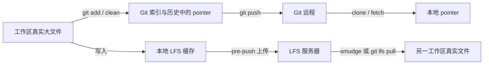
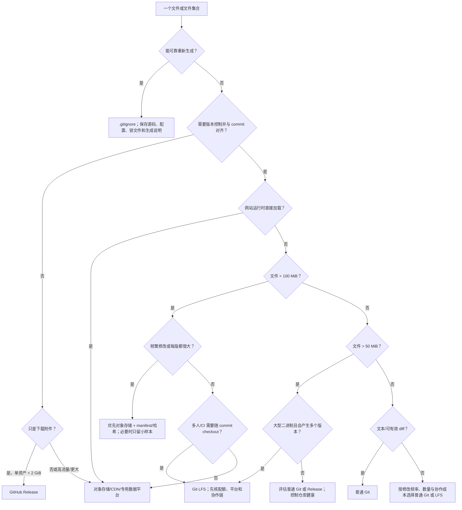

<!-- Generated by scripts/sync-obsidian-notes.mjs from Obsidian Publish. Do not edit by hand. -->

## Git LFS：Git 大文件存储、迁移与协作实践

Git Large File Storage（Git LFS，Git 大文件存储）是 Git 的扩展：Git 历史保存一个很小的文本指针，真实的大文件由独立的 LFS 服务保存。它解决的是“大型、需要版本化的二进制资产拖累 Git”这一问题，不是无限存储、备份系统、下载 CDN，也不能保护敏感信息。

> **Abstract: 先记住四个判断**
> 1. 能重新生成的文件优先放进 `.gitignore`，不要放 Git LFS。
> 2. 只供用户下载的安装包优先用 GitHub Releases；网站运行时的大资产优先用对象存储/CDN。
> 3. 需要与源码提交一起版本化、多人协作的大型二进制文件，才是 Git LFS 的核心场景。
> 4. `git lfs track` 只影响以后加入索引的内容，不会自动清理旧历史；历史迁移是另一项高风险工程。

### 1. Git 为什么会被大文件拖慢

#### 1.1 对象数据库、blob 与历史

Git 在 `.git/objects` 或 packfile（打包文件）中保存内容寻址的对象。常见对象包括：

- **blob（binary large object）**：文件内容，不保存文件名；相同内容可复用同一个对象。
- **tree**：目录快照，记录文件名、权限及对应对象。
- **commit**：指向一个 tree、父提交和作者等元数据，形成历史图。

提交一个文件时，Git 将该版本的内容作为 blob 纳入对象数据库。以后从工作区删除文件，只是新提交不再引用它；只要旧提交、标签或其他 ref（引用）仍能到达旧 blob，它就仍在历史中。即使成为不可达对象，也要等引用清理和垃圾回收后才可能真正释放空间。因此“删除文件再提交”不能消除过去已经推送的大对象。

Git 对文本很擅长：可以逐行 diff（差异比较）、合并并压缩相似内容。多数 CAD、视频、压缩包、PSD 和模型权重是二进制格式；修改很少的逻辑内容，也可能让大量字节变化。Git 的 pack delta（包内差量压缩）有时能节省空间，但不能把它当作可靠的二进制增量存储方案。每个难以压缩或求差量的新版本都会继续扩大仓库，克隆者又通常要取得可达历史中的对象。

#### 1.2 500 MB × 5 个版本

假设一个 500 MB 的二进制文件被修改并提交 5 次：

| 方式 | Git 对象数据库 | 独立大文件存储 | 新克隆的典型下载 | 逻辑存储量（忽略压缩与重复内容） |
|---|---:|---:|---:|---:|
| 普通 Git | 5 个大型 blob | 无 | Git 历史可能接近 2.5 GB | 约 2.5 GB |
| Git LFS | 5 个约百余字节的 pointer | 5 个 LFS 对象 | Git 历史很小；默认再取当前 500 MB | LFS 端仍可能约 2.5 GB |

关键区别是把大内容从 Git 对象传输路径中移开，并允许按需下载；**Git LFS 通常仍把每个新版本保存为新的完整 LFS 对象**。改 1 byte 后再推送 500 MB 文件，GitHub 的官方计费示例也按新增 500 MB 存储计算。LFS 优化的是 Git 仓库与工作流，不保证二进制增量去重。

### 2. Git LFS 的核心工作原理

#### 2.1 pointer file 与 LFS object

- **pointer file（指针文件）**：进入普通 Git 历史的小型文本文件。
- **LFS object（LFS 对象）**：真实二进制内容，保存在本地 `.git/lfs/objects` 缓存以及远程 LFS 服务中。
- **OID（object ID，对象标识）**：由真实内容计算出的 SHA-256 摘要；内容相同则 OID 相同。

GitHub 官方示例中的真实格式如下：

```text
version https://git-lfs.github.com/spec/v1
oid sha256:4cac19622fc3ada9c0fdeadb33f88f367b541f38b89102a3f1261ac81fd5bcb5
size 84977953
```

- `version .../spec/v1`：pointer 格式规范版本，不是客户端版本号。
- `oid sha256:...`：真实文件内容的 SHA-256 OID，客户端用它定位并校验 LFS 对象。
- `size 84977953`：真实文件的字节数，用于校验与展示。

普通 Git 远程保存 commit、tree、pointer blob；LFS 服务器保存 OID 对应的大内容。两套存储有关联但生命周期、配额和传输接口不同。只备份 Git 仓库而没有 LFS 对象，可能只剩 pointer，所以 Git LFS 不能替代完整备份。

#### 2.2 `.gitattributes` 与过滤器

`.gitattributes` 是随仓库版本化的路径属性规则。典型规则是：

```gitattributes
*.zip filter=lfs diff=lfs merge=lfs -text
```

- `filter=lfs`：对匹配路径启用 LFS 内容过滤。
- `diff=lfs`：选择 LFS diff 驱动；它不会让 ZIP/CAD 获得语义级差异比较。
- `merge=lfs`：选择 LFS merge 属性；二进制冲突通常仍需人工选择版本或借助领域工具。
- `-text`：明确按非文本处理，禁用行尾规范化，避免二进制内容被改写。

四个关键组件的职责：

1. **clean filter**：`git add` 把文件写入索引时读取真实内容，将内容放入本地 LFS 缓存，并让 Git 索引保存 pointer。
2. **smudge filter**：checkout 时读取 pointer，按需下载真实对象并把真实内容写入工作区。
3. **filter-process**：Git 的长驻过滤进程协议，在一个进程中处理 clean/smudge 请求，减少重复启动开销；现代 Git LFS 主要走这条路径。
4. **pre-push hook**：`git push` 前扫描将推送提交引用的 LFS OID，把远程缺少的 LFS 对象先上传；缺对象或上传失败时应阻止引用推送，避免远程出现无法取回的 pointer。

#### 2.3 clone、checkout、pull、push 分别发生什么



- **clone**：先取得 Git 历史和 pointer；默认 smudge 再下载当前检出提交需要的 LFS 对象。
- **checkout/switch**：Git 切换 pointer；对象已缓存则直接展开，未缓存时由过滤器下载。设置跳过 smudge 后会保留 pointer。
- **pull**：Git 拉取并合并/快进提交，checkout 阶段通常取所需 LFS 对象；`git lfs pull` 明确执行“LFS fetch + checkout”。
- **push**：pre-push 先上传缺失 LFS 对象，再推普通 Git 对象与 refs。跳过或损坏 hook 可能造成 LFS 上传遗漏。

### 3. 普通 Git 与 Git LFS 对比

| 维度 | 普通 Git | Git LFS |
|---|---|---|
| 存储位置 | Git 对象数据库与普通远程 | Git 保存 pointer；内容在 LFS 服务 |
| 克隆行为 | 取得可达 Git 对象 | 先取 pointer，当前对象通常自动下载，可跳过 |
| 历史体积 | 每个大版本可能进入 Git 历史 | Git 历史只有小 pointer；LFS 端仍保留大版本 |
| 下载方式 | clone/fetch 随 Git 对象传输 | smudge、`lfs pull/fetch`，可 include/exclude |
| diff 能力 | 文本优秀；二进制有限 | 仍不提供通用 CAD/视频语义 diff |
| 协作要求 | 安装 Git 即可 | 每位开发者、CI、部署端要理解/安装 LFS |
| 版本管理 | commit 精确引用 blob | commit 精确引用某个 OID 和大小 |
| 存储/带宽成本 | 受仓库限制 | 受 LFS 存储、下载带宽和单文件限制 |
| CI/CD | checkout 后通常是完整文件 | 未启用 LFS 可能只有 pointer；下载计费 |
| 文本文件 | 首选 | 通常不适合，失去高质量 diff/merge |
| 大型二进制文件 | 容易膨胀或触及上限 | 合适，但须评估修改频率、配额和协作链 |

### 4. 适用与不适用场景

#### 4.1 通常适合

- SolidWorks `.sldprt`、`.sldasm`，以及需要与设计提交同步的 STEP/STP、IGES/IGS。
- 视频、音频、PSD、大型 PDF 等无法有效文本 diff 的源资产。
- 需要复现实验的数据集子集、机器学习模型权重、机器人日志包、仿真资产。
- 文件确实需要版本、评审、按 commit 对齐，并由多个协作者修改或复现。

“类型合适”不等于“全部加入”。高频修改的 5 GB 文件，每次都可能新增完整对象并让 CI 反复下载，LFS 成本可能仍不可接受。应先拆分、降低频率、只跟踪代表性样本，或改用对象存储加清单/校验和。

#### 4.2 通常不适合

- `node_modules/`、`dist/`、`build/`、缓存、普通日志、临时文件：可重新安装或生成，应 `.gitignore`。
- 可重新生成的仿真输出和编译产物：保存生成脚本、配置、版本和种子更可靠。
- 数据库备份：往往高频、敏感且整体变化，适合专用备份/对象存储及保留策略。
- API 密钥、凭据、个人数据：LFS 不是加密或秘密管理器；应使用 secrets 管理，泄露后立即轮换。
- 高频修改的超大文件：每版完整对象会快速消耗存储与下载带宽。
- 只用于下载分发的安装包：优先 GitHub Releases 或对象存储/CDN。

#### 4.3 选择哪一种存储

| 方案 | 最适合 | 不适合 |
|---|---|---|
| 普通 Git | 源码、Markdown、配置、小型图片 | 大型、多版本二进制 |
| Git LFS | 与 commit 强绑定、需要协作版本化的大二进制源资产 | 缓存、秘密、高频快照、网站 CDN |
| GitHub Releases | 按版本供用户下载的安装包、固件、发布归档 | 开发中逐提交修改的源资产 |
| 对象存储/CDN | 网站运行时媒体、大数据集、模型、日志归档、高下载量 | 需要原生 Git checkout 体验的少量资产 |
| 云盘/文件共享 | 临时交换、办公室协作、数据库交付 | 可复现版本与自动化依赖 |
| `.gitignore` | 依赖、缓存、构建产物、临时文件 | 必须被别人精确复现且无法生成的输入 |

### 5. 安装和初始化

截至 2026-07-12，Git LFS 官网发布的当前版本为 **3.7.1**。版本会变化，安装前应再次查看[Git LFS 官网](https://git-lfs.com/)和[官方 Releases](https://github.com/git-lfs/git-lfs/releases)。

#### 5.1 Windows

从官网下载安装程序；安装器可能更新 `PATH`，完成后重新打开 PowerShell 或 Git Bash。Git for Windows 的具体发行方式可能已经附带 LFS，但仍应验证。

**影响**：下列检查只读；不修改仓库、不改写历史、不需要 push，任何仓库都可执行。

```powershell
git lfs version
```

#### 5.2 macOS

**影响**：包管理器会修改系统/用户软件环境，但不改仓库；不改写历史、不需要 push。

```bash
brew install git-lfs
# 或：sudo port install git-lfs
git lfs version
```

#### 5.3 Linux

可使用发行版包（版本可能较旧），或按官网提供的 PackageCloud/二进制安装说明操作。

**影响**：安装软件包会修改系统；不改仓库历史，不需要 push。

```bash
# Debian/Ubuntu 仓库提供该包时
sudo apt install git-lfs

# Fedora 仓库提供该包时
sudo dnf install git-lfs

git lfs version
```

#### 5.4 用户级初始化

**影响**：会在全局 Git 配置中建立 `filter.lfs.clean`、`smudge`、`process` 等设置；若在仓库内执行，还会安装/更新当前仓库的 pre-push hook。它不跟踪任何文件、不改写历史、不需要 push。若已有自定义 pre-push hook，先备份并用 `git lfs install --manual` 检查整合方式。

```bash
git lfs install
```

过滤器通常是用户级配置，所以每个用户账户通常只需运行一次；每个仓库仍需有自己的 `.gitattributes`，hook 也可能需按仓库安装。`git lfs install --local` 可把过滤器限制在当前仓库，但不是默认建议。

### 6. 在新文件上配置 Git LFS

先决定扩展名是否真的代表需要版本化的源资产，不要使用 `git lfs track "*"`。

**影响**：`track` 会创建或修改当前仓库 `.gitattributes`，不改写历史，不自动提交或 push；适用于新仓库和共享仓库，但规则应经过团队确认。

```bash
git lfs track "*.zip"
git lfs track "*.mp4"
git lfs track "*.step"
git lfs track "*.sldprt"
```

生成的规则类似：

```gitattributes
*.zip filter=lfs diff=lfs merge=lfs -text
```

`.gitattributes` 必须提交：它是“哪些路径应该变成 pointer”的协作契约。没有它，新克隆、fork 和 CI 可能把同一扩展名作为普通 blob 提交。

**影响**：下面会修改索引、创建本地提交并上传到远程；不改写旧历史，适合共享仓库的正常新增流程。执行 push 前确认配额、远程和分支正确。

```bash
git add .gitattributes
git add path/to/file.zip
git commit -m "assets: add large file through Git LFS"
git push origin main
```

先提交 `.gitattributes` 与文件在同一提交通常可行；更保守的团队也可先单独提交规则，再提交资产。

### 7. 如何验证 Git LFS 是否生效

**影响**：以下命令全部只读，不修改工作区、不改历史、不需要 push，适合共享仓库。

```bash
git lfs track
git lfs ls-files
git lfs status
git check-attr -a -- path/to/file
git show HEAD:path/to/file
```

判断方法：

1. `git lfs track` 应列出来源于 `.gitattributes` 的规则。
2. `git lfs ls-files` 应列出目标路径和 OID。
3. `git lfs status` 区分待提交、待推送的 LFS 对象。
4. `git check-attr` 应看到 `filter: lfs`、`diff: lfs`、`merge: lfs`、`text: unset`。
5. `git show HEAD:path/to/file` 读取的是 Git 历史内容：正确时是三行 pointer，不应输出完整二进制内容。工作区看到真实文件是正常的，因为 smudge 已展开。

GitHub 网页端有时直接显示 pointer，可能是 LFS 对象未上传、配额阻断、下载/渲染不支持，或你查看的是默认不包含 LFS 对象的源码归档。pointer 本身出现在 Git 历史是正常机制；“网页显示 pointer”不等同于文件内容丢失，但必须验证 LFS 对象可下载。

### 8. 已存在文件的处理方式

#### A. 文件尚未被 Git 跟踪

这是最安全场景。先添加跟踪规则，再 add 文件，确保第一次进入索引的就是 pointer。

**影响**：修改 `.gitattributes` 和索引，之后正常 commit/push；不改写历史，适合共享仓库。

```bash
git lfs track "*.zip"
git add .gitattributes
git add path/to/file.zip
git lfs ls-files
git commit -m "assets: track ZIP with Git LFS"
git push origin main
```

#### B. 文件已加入暂存区但尚未提交

暂存区可能已经含完整 blob。配置规则后必须让 Git 重新走 clean filter。

**影响**：只重建该路径的索引条目，保留工作区文件；不改历史、不需强推，之后正常 commit/push，适合共享仓库。

```bash
git lfs track "*.zip"
git add .gitattributes
git rm --cached -- path/to/file.zip
git add -- path/to/file.zip
git show :path/to/file.zip
```

也可在确认规则无误后对明确路径使用 `git add --renormalize -- path/to/file.zip`。不要无审查地对整个仓库 renormalize，以免连带行尾或其他属性变化。

#### C. 文件只存在于最后一个本地提交，尚未共享

**影响**：`--amend` 会改写最后一个本地提交及其 SHA；不触碰更早历史。仅适用于目标大文件第一次出现于最后一条提交且从未推送/共享的情况。完成后才正常 push；不适用于已共享提交。

```bash
git lfs track "*.zip"
git add .gitattributes
git rm --cached path/to/file.zip
git add path/to/file.zip
git commit --amend --no-edit
```

如果文件在更早提交已出现，amend 只修复当前快照，旧大 blob 仍在历史中。

#### D. 文件存在于多个历史提交或已经推送

先只读评估，再把迁移当成计划内维护窗口。官方命令手册说明：`info` 汇总文件类型/大小；`import` 把普通 Git blob 改为 LFS pointer；`--include` 限定路径模式；`--everything` 检查所有本地和远程 refs 可达的提交，但实际只更新本地 refs。

**影响**：下列 `info` 只读，但默认可能 fetch 远程 refs；不改写历史、不自动 push。共享仓库可安全用于评估，离线时可研究 `--skip-fetch` 的取舍。

```bash
git lfs migrate info --everything
```

> **Danger: 历史重写：不要在日常工作区直接复制执行**
> 下列 `import` 会改写匹配文件经过的提交，导致该提交及所有后代 SHA 改变，并可能修改历史中的 `.gitattributes`。它不会自动修改远程，但要让远程采用新历史通常需要协调后的强制推送。执行前必须完成第 9 节清单、备份、冻结推送并获得仓库所有者许可。本文没有执行该命令。

```bash
git lfs migrate import --include="*.zip,*.mp4" --everything
```

SHA 改变意味着旧分支、PR、标签、子模块锁定值、部署记录和签名都可能受影响。协作者若在旧历史上继续工作，会把旧对象重新带回；通常最安全的恢复方式是重新克隆，再把尚未合入的工作用补丁或审查后的 cherry-pick 移植。

迁移后的远程更新可能需要强制推送。`--force` 无条件用本地 ref 覆盖远程；`--force-with-lease` 仅在远程仍符合本地预期值时覆盖，可防止误删迁移期间出现的新提交，但不能消除历史重写本身的破坏性。

> **Danger: 远程历史覆盖示例，仅供维护方案审查**
> 确认备份、保护规则、所有 refs 范围和协作者停写后才可考虑。不要把 `--force-with-lease` 理解为“安全无风险”，更不要在未确认远程状态时使用 `--force`。本文没有执行任何 push。

```bash
# 相对更有保护，但仍是历史覆盖
git push --force-with-lease origin main

# 无条件覆盖，风险更高；通常不应作为默认方案
git push --force origin main
```

### 9. 历史迁移安全操作清单

#### 执行前

- [ ] 在专用克隆中操作，`git status --porcelain` 必须为空。
- [ ] 获取全部远程 refs 和 tags，确认默认分支、活跃分支及隐藏依赖。
- [ ] 创建 mirror clone、`git bundle` 或等价完整备份，并在另一路径验证可读。
- [ ] 记录 `git remote -v`、分支、标签、提交 SHA 和 LFS endpoint。
- [ ] 用 `git lfs migrate info --everything` 检查受影响扩展名、路径、数量和大小。
- [ ] 精确设计 `--include`/`--exclude`；避免为了省事迁移所有内容。
- [ ] 通知所有协作者，约定维护窗口，暂停 push、merge、机器人写入。
- [ ] 确认分支保护是否允许维护者暂时覆盖，以及恢复时间。
- [ ] 审计 CI、部署、release、子模块、签名提交、PR 和外部 SHA 引用。
- [ ] 确认 GitHub LFS 单文件限制、配额、预算和预期上传量。

#### 执行中

- [ ] 保存迁移命令、Git LFS/Git 版本与开始时间。
- [ ] 只对已批准的 refs 和模式运行，保留完整日志与 old→new SHA 映射。
- [ ] 不在迁移副本中混入内容编辑。
- [ ] 发现范围异常、缺 LFS 对象、工作区覆盖提示时立即停止，不使用 `--yes` 掩盖风险。
- [ ] 在触碰远程前审查新历史、`.gitattributes` 和对象数量。

#### 执行后

- [ ] 检查 `git lfs ls-files`、`git lfs status` 与 `git lfs fsck`。
- [ ] 检查 Git 历史、分支、标签、提交数量及关键文件内容。
- [ ] 确认所有所需 LFS 对象已上传，且远程无完整大 blob 拒绝错误。
- [ ] 在临时空目录测试全新 clone 和关键分支 checkout。
- [ ] 用跳过 smudge 的 clone 测试“没有/未启用 Git LFS”的 pointer 降级行为。
- [ ] 测试 CI、构建、部署、release 和子模块更新。
- [ ] 恢复保护规则和自动化写入。
- [ ] 通知协作者废弃旧克隆并重新克隆，提供未合入工作迁移方案。
- [ ] 保留备份到约定的回滚窗口结束；不要立即清理旧对象。

### 10. 克隆、拉取与按需下载

**影响**：以下命令下载内容并可能更新工作区，但不改写 Git 历史；本身不需要 push，适合共享仓库。`fetch --all` 可能下载巨大历史，仅用于迁移/备份验证，不是日常默认命令。

```bash
git clone https://github.com/OWNER/REPO.git
git lfs pull
git lfs fetch
git lfs checkout
git lfs fetch --all
```

- `git clone`：默认取得 Git 数据，并在 checkout 时 smudge 当前提交所需对象。
- `git lfs pull`：下载当前 ref 所需对象并展开工作区，近似 `fetch` + `checkout`。
- `git lfs fetch`：只放入本地 LFS 缓存，不改工作区；默认针对当前 ref。
- `git lfs checkout`：只用本地已有对象替换 pointer，不联网下载，也不覆盖已修改文件。
- `git lfs fetch --all`：下载指定 refs（未指定则所有 refs）可达的全部 LFS 对象，忽略 include/exclude，适合迁移和完整性准备。

#### 10.1 克隆时暂不下载大文件

**影响**：环境变量只影响该命令的 smudge；工作区保留 pointer，之后可按需 pull。不改历史、不需 push。

PowerShell：

```powershell
$env:GIT_LFS_SKIP_SMUDGE = "1"
git clone https://github.com/OWNER/REPO.git
Remove-Item Env:GIT_LFS_SKIP_SMUDGE
```

Bash：

```bash
GIT_LFS_SKIP_SMUDGE=1 git clone https://github.com/OWNER/REPO.git
```

#### 10.2 只取当前分支、目录或模式

**影响**：下载选定对象并可能由 `pull` 更新工作区；不改历史、不需 push。模式遵循 Git LFS 文档所述的 gitignore 风格匹配。

```bash
# 当前分支需要的对象
git lfs pull

# 只下载 mechanical 与 vision/models，排除归档视频
git lfs pull --include="mechanical/**,vision/models/**" --exclude="videos/archive/**"

# 只放入缓存，稍后再展开
git lfs fetch --include="test-data/**/*.mcap"
git lfs checkout "test-data/**"
```

也可用 `lfs.fetchinclude`/`lfs.fetchexclude` 写入 Git 配置，但 CI 中更推荐在命令行明确声明，避免 runner 的隐式全局状态。缩小 sparse checkout、当前 ref 和 LFS include 范围，能同时减少本地等待和仓库所有者的 LFS 下载带宽。

### 11. GitHub Actions 与 CI/CD

`actions/checkout` 默认不一定把 LFS pointer 展开。以下 v5 示例：

**影响**：这是文档示例，不会修改当前仓库。实际加入 workflow 后，每次运行会下载当前 checkout 所需 LFS 对象，消耗仓库所有者的 LFS 带宽；不改历史，但 workflow 文件需要正常 commit/push。`actions/checkout` 上游截至核对日已展示更新的主版本，采用 v5 时还要满足其 Node 24/runner 版本要求，生产中应复核当前受支持版本。

```yaml
- uses: actions/checkout@v5
  with:
    lfs: true
```

- 不设置 `lfs: true`，构建脚本可能读到三行 pointer，进而生成损坏包或报格式错误。
- GitHub 官方计费示例明确：Actions 下载 500 MB LFS 文件，计入仓库所有者 500 MB 下载带宽。
- runner 缓存、依赖缓存和构建产物应使用 Actions cache/artifact 或外部制品库，不应默认提交到 LFS。
- 先检查部署平台是否安装/支持 Git LFS，尤其不要假定静态托管会解析 pointer。
- 用 sparse checkout、include/exclude、分 job 或预制制品避免每次 CI 下载不需要的 CAD、视频和全量数据集。
- 缓存 LFS 内容前确认缓存键、淘汰策略与许可；缓存并不会免除第一次下载，也不能替代源对象完整性检查。

### 12. GitHub 当前限制与计费

> **Warning: 时效信息（核对日期：2026-07-12）**
> 本节是 GitHub.com/GitHub Enterprise Cloud 当前规则，不等于 Git LFS 协议本身，也不一定适用于自建 LFS 或 GitHub Enterprise Server。方案与计费会变化，执行迁移前应重新打开本节链接核对。

#### 12.1 普通 Git 与 LFS 单文件限制

| 项目 | 当前限制 |
|---|---:|
| 浏览器向仓库上传单文件 | 25 MiB |
| 普通 Git 警告阈值 | 大于 50 MiB |
| 普通 Git 硬性单对象/单文件限制 | 大于 100 MiB 被阻止 |
| GitHub Free 的 LFS 单文件上限 | 2 GB |
| GitHub Pro 的 LFS 单文件上限 | 2 GB |
| GitHub Team 的 LFS 单文件上限 | 4 GB |
| GitHub Enterprise Cloud 的 LFS 单文件上限 | 5 GB |

来源：[About large files on GitHub](https://docs.github.com/en/repositories/working-with-files/managing-large-files/about-large-files-on-github)、[About Git Large File Storage](https://docs.github.com/en/repositories/working-with-files/managing-large-files/about-git-large-file-storage)。注意 GitHub 文档对普通 Git 使用 MiB，对 LFS 方案表使用 GB，本文保留官方单位。

#### 12.2 方案包含额度

各计划的包含额度和计费细则会变化，使用前请查看 [GitHub 官方计费文档](https://docs.github.com/en/billing/concepts/product-billing/git-lfs) 和账户的实际预算设置。

#### 12.3 如何计量

- **上传**：上传到 LFS 的完整对象增加仓库所有者存储，不计下载带宽。
- **修改再上传**：即便只改 1 byte，新版本通常按整个文件再次增加存储。
- **下载**：下载完整对象按大小计入仓库所有者带宽。
- **Fork**：fork 和从 fork/父仓库拉取的存储、带宽归父仓库/原仓库所有者账户计算。
- **Actions**：runner 下载 LFS 对象计入仓库所有者带宽。
- **源代码 ZIP/tar.gz**：默认归档通常只含 pointer；仓库管理员若开启“Include Git LFS objects in archives”，每次归档下载都计入带宽。

归档规则来源：[Managing Git LFS objects in archives](https://docs.github.com/en/repositories/managing-your-repositorys-settings-and-features/managing-repository-settings/managing-git-lfs-objects-in-archives-of-your-repository)。

#### 12.4 超额、预算与删除

- 预算设为 `$0` 时，GitHub 当前说明不会产生超额费用，但 LFS 使用会被阻止到当月结束；删除预算则表示无支出上限，超额按实际使用计费。
- 无有效付款方式且超存储额度时，clone 可能只取到 pointer，且不能继续推新 LFS 文件；超下载带宽时，LFS 支持可能停用到下月。
- 有付款方式时仍可能受一个或多个 hard budget（达到后停止使用）约束；soft budget 只告警。应同时检查个人、组织、企业和仓库作用域预算。
- 删除工作区文件或普通 Git 引用不会自动立刻降低远程 LFS 账单。GitHub 按与仓库关联的所有 LFS 对象计量；当月中途删除对象也不会回算当月已累计用量。需要按 GitHub 的移除流程和支持边界处理。

#### 12.5 Releases 的不同边界

截至同一核对日，GitHub Releases 每个 release 最多 1000 个资产，每个资产小于 2 GiB；release 总大小和下载带宽当前不设总上限。它适合版本化分发安装包/固件，而不是逐提交的协作源文件。来源：[About releases](https://docs.github.com/en/repositories/releasing-projects-on-github/about-releases)。

### 13. GitHub Pages 特别说明

> **Danger: GitHub 官方当前明确写明：Git LFS 不能用于 GitHub Pages 站点**
> 核对日期：2026-07-12。来源：[About Git Large File Storage](https://docs.github.com/en/repositories/working-with-files/managing-large-files/about-git-large-file-storage)。不要假定 Pages 会读取 pointer、调用 LFS API 或自动把真实内容部署到站点。

#### Astro 个人网站策略

- **运行时图片**：经过压缩、尺寸合理的站点图片可放普通 Git/public 资产；大量原图、超大图集放对象存储/CDN，并在 Astro 中引用稳定 URL。不要用 LFS 作为 Pages 图片源。
- **视频**：优先视频平台或对象存储/CDN；避免把高流量视频随 Pages 构建或仓库 clone 分发。
- **大型 PDF**：小而稳定、需随站点发布的 PDF 可普通 Git；作为版本下载附件且小于 release 限制时用 Release；高流量或更大文件用对象存储。LFS 不适合作为 Pages 链接后端。
- **构建期大文件**：即使 Actions 通过 `lfs: true` 下载并把成品打入部署 artifact，也会增加构建失败面、时间与 LFS 带宽，并与“Pages 不支持 LFS”的官方边界冲突。不要把这种偶然可行路径当成受支持架构。
- **独立资产仓库**：只有资产有独立权限、版本和生命周期时才拆仓；若主要是网页公开加载，独立对象存储桶/CDN 通常比“独立 LFS 仓库”合适。

**明确结论**：Astro + GitHub Pages 中，源码、Markdown、优化后的小图片用普通 Git；发布附件用 Releases；视频、原始图片、大数据和高流量 PDF 用对象存储/CDN。不要为 Pages 运行时资产设计 Git LFS 依赖。

### 14. RoboMaster 和机械工程项目示例

```text
robot-project/
├─ firmware/
├─ control/
├─ vision/
├─ mechanical/
│  ├─ solidworks/
│  ├─ step/
│  └─ drawings/
├─ test-data/
├─ videos/
├─ docs/
├─ .gitattributes
└─ .gitignore
```

不要把整个 `mechanical/`、`test-data/` 或 `videos/` 无差别交给 LFS：README、参数表、脚本、小型 SVG 和数据说明仍应保留普通 Git 的 diff 能力。一个经过审查的示例：

```gitattributes
# CAD 原生与中性交换格式
*.sldprt filter=lfs diff=lfs merge=lfs -text
*.sldasm filter=lfs diff=lfs merge=lfs -text
*.step    filter=lfs diff=lfs merge=lfs -text
*.stp     filter=lfs diff=lfs merge=lfs -text
*.iges    filter=lfs diff=lfs merge=lfs -text
*.igs     filter=lfs diff=lfs merge=lfs -text

# 仅跟踪明确需要版本化的演示视频
videos/**/*.mp4 filter=lfs diff=lfs merge=lfs -text
videos/**/*.mov filter=lfs diff=lfs merge=lfs -text

# 仅跟踪用于回归的代表性机器人数据包
test-data/**/*.bag  filter=lfs diff=lfs merge=lfs -text
test-data/**/*.mcap filter=lfs diff=lfs merge=lfs -text
```

适合 `.gitignore` 的例子：

```gitignore
# 固件、控制和视觉构建产物
firmware/build/
control/build/
vision/.cache/

# Python/ROS/IDE 缓存
__pycache__/
*.pyc
.vscode/

# SolidWorks 临时锁文件与自动恢复文件（按团队软件版本复核）
~$*.sldprt
~$*.sldasm

# 原始全量日志和可重新生成的仿真输出
logs/
simulation/output/
test-data/raw/
```

决策依据：固件源码、控制算法、标定 YAML、URDF/Xacro、Markdown 和小型图纸普通 Git；不可再生且需与实验提交绑定的少量 bag/mcap 用 LFS；全量比赛日志进入对象存储并在清单中记录 URL、SHA-256、采集固件 commit 和许可；发布给队员下载的固定工具包/固件用 Release；编译与仿真输出忽略。

### 15. 常见错误与排查

以下故障统一按“现象—原因—检查—修复—风险”记录。检查命令默认只读；任何迁移命令都另行标警。

#### 15.1 `File exceeds GitHub's file size limit of 100.00 MB`

- **现象**：push 被 GitHub 拒绝，并指出某普通 Git blob 超过 100 MB。
- **原因**：大文件已作为普通 blob 进入正在推送的提交；事后 `track` 不会改旧索引/历史。
- **检查命令**：`git lfs ls-files`、`git show HEAD:path/to/file`、`git lfs migrate info`。
- **修复方法**：未提交则重新 add；仅最后一个未共享提交则 amend；更早/已共享历史按第 9 节评估迁移。
- **历史重写风险**：前两种无或仅本地 amend；历史迁移为高风险。

#### 15.2 已执行 `git lfs track`，但 push 仍失败

- **现象**：规则存在，GitHub 仍报告大 blob。
- **原因**：文件在规则创建前已进入索引或提交，或路径没有匹配（大小写/目录/引号问题）。
- **检查命令**：`git check-attr -a -- path/to/file`、`git show :path/to/file`、`git show HEAD:path/to/file`。
- **修复方法**：未提交时 `git rm --cached` 后重新 `git add`；已提交按 A-D 场景处理。
- **历史重写风险**：取决于文件是否已进入历史；修改规则本身不会清旧历史。

#### 15.3 克隆后看到的是 LFS pointer

- **现象**：文件只有 `version/oid/size` 三行。
- **原因**：未安装 LFS、使用了 `GIT_LFS_SKIP_SMUDGE=1`、对象下载失败/缺失或配额被阻断。
- **检查命令**：`git lfs version`、`git lfs env`、`git lfs status`、`git lfs fsck`。
- **修复方法**：安装后运行 `git lfs install` 与 `git lfs pull`；若远端缺对象，让拥有对象者补传；检查配额。
- **历史重写风险**：无。

#### 15.4 `git: 'lfs' is not a git command`

- **现象**：Git 无法找到 `lfs` 子命令。
- **原因**：Git LFS 未安装，或安装后终端仍使用旧 `PATH`。
- **检查命令**：PowerShell `Get-Command git-lfs`；Bash `command -v git-lfs`；`git lfs version`。
- **修复方法**：按官方安装说明安装，重开终端，确认 Git 与 git-lfs 来源符合预期。
- **历史重写风险**：无。

#### 15.5 `batch response: This repository is over its data quota`

- **现象**：LFS 下载或上传被拒绝。
- **原因**：所有者账户存储/带宽配额、付款方式或预算限制。
- **检查命令**：`git lfs env`；仓库所有者在 GitHub Billing & Licensing 查看 LFS usage/budgets。
- **修复方法**：所有者调整预算/付款方式、等待带宽周期重置，或按官方流程降低未来用量；不要重复重试制造流量。
- **历史重写风险**：单纯计费处理无；改变历史以降用量则高风险且不会回算已发生用量。

#### 15.6 LFS 文件没有上传

- **现象**：Git ref 已存在，但他人无法下载对象，或完整性检查阻止 push。
- **原因**：pre-push hook 缺失/冲突、传输中断、本地没有被引用对象。
- **检查命令**：`git lfs status`、`git lfs fsck`、检查 `.git/hooks/pre-push` 和 `git lfs env`。
- **修复方法**：先确认本地对象完整，再运行 `git lfs install`；官方故障页给出 `git lfs push --all origin` 补传所有被引用对象，但它会大量上传，执行前确认远程、配额和范围。
- **历史重写风险**：补传不重写历史，但会修改远程 LFS 存储并产生存储用量。

#### 15.7 `.gitattributes` 没有提交

- **现象**：本人正常，协作者/CI 把同类文件当普通 Git 或只得到不一致行为。
- **原因**：规则只在本地工作区，未成为仓库历史的一部分。
- **检查命令**：`git status -- .gitattributes`、`git show HEAD:.gitattributes`。
- **修复方法**：审查后提交 `.gitattributes`；重新加入尚未提交的匹配文件。
- **历史重写风险**：提交规则无；过去的普通 blob 不会自动迁移。

#### 15.8 Windows 路径和通配符问题

- **现象**：含空格、括号、中文或反斜杠的路径不匹配，PowerShell 提前展开 `*`。
- **原因**：shell quoting 与 `.gitattributes` 模式是两层语法；规则使用仓库相对路径和 `/`，不是 Windows `\`。
- **检查命令**：`git check-attr -a -- "path with spaces/file.zip"`、`git lfs track`。
- **修复方法**：命令中的 glob 用引号包裹，如 `git lfs track "*.zip"`；规则中使用 `/`；先对一个样本验证。
- **历史重写风险**：无，除非为修旧提交另做迁移。

#### 15.9 修改跟踪规则但旧历史仍然很大

- **现象**：新提交已是 pointer，clone 或 `.git` 仍很大。
- **原因**：旧 commits 仍引用普通 blob；LFS 规则不具追溯效力，本地也可能保留不可达对象。
- **检查命令**：`git lfs migrate info --everything`、`git count-objects -vH`、大 blob 审计。
- **修复方法**：接受旧历史，或按维护项目执行历史迁移；不要先用 aggressive GC 掩盖缺少备份的问题。
- **历史重写风险**：真正清理共享历史为高风险。

#### 15.10 CI 中只有 pointer

- **现象**：构建读到百余字节文本而非模型、媒体或 CAD。
- **原因**：checkout 未启用 LFS，runner 没安装 LFS，或 skip-smudge/include 规则排除了路径。
- **检查命令**：CI 中运行 `git lfs version`、`git lfs ls-files`、`git lfs status`，并检查文件头/大小。
- **修复方法**：配置 checkout 的 `lfs: true`，或显式 `git lfs pull --include=...`；最小化下载范围。
- **历史重写风险**：无，但下载消耗 LFS 带宽。

#### 15.11 协作者没有安装 Git LFS

- **现象**：checkout 失败、看到 pointer，或提交真实大 blob 的行为不一致。
- **原因**：缺少过滤器与 hook。
- **检查命令**：`git lfs version`、`git config --show-origin --get-regexp '^filter\.lfs\.'`。
- **修复方法**：把安装/验证写进贡献指南和开发环境 bootstrap；在 CI 加 pointer 检查。
- **历史重写风险**：无；但误提交的大 blob 可能需要后续处理。

#### 15.12 删除文件后远程 LFS 存储仍未减少

- **现象**：当前分支已删除文件，账单存储仍存在。
- **原因**：旧 commit/ref 仍引用对象，Git 与 LFS 存储独立；GitHub 计量与清理不是工作区删除即释放，当月用量也不回算。
- **检查命令**：`git lfs ls-files --all`（按当前客户端支持情况）、`git lfs migrate info --everything`，并查看 GitHub usage。
- **修复方法**：先确认保留策略；需要服务端删除时遵循 GitHub 官方“Removing files from Git LFS”流程/联系支持。不要仅为账单盲目改历史。
- **历史重写风险**：若移除所有历史引用则高风险；服务端清理还可能让旧 commit 永久不可用。

#### 15.13 LFS push 卡住或代理连接失败

- **现象**：batch 请求、TLS、407、超时或重试停滞。
- **原因**：代理/证书、SSH 与 HTTPS LFS endpoint 不一致、防火墙、并发、凭据或服务状态。
- **检查命令**：`git lfs env`、`git config --show-origin --get-regexp 'http\.|lfs\.'`、`GIT_TRACE=1 GIT_CURL_VERBOSE=1 git lfs push --dry-run origin main`（日志可能包含敏感 URL/头，分享前脱敏）。
- **修复方法**：核对系统和 Git 代理、企业 CA、凭据、LFS endpoint 与 GitHub Status；必要时降低并发并由网络管理员处理。不要关闭 TLS 验证作为长期方案。
- **历史重写风险**：无，但实际重试上传会消耗时间和存储；`--dry-run` 不上传。

### 16. 如何停止使用或移除 Git LFS

这是三个不同任务：

1. **停止跟踪新文件**：以后匹配文件不再自动进入 LFS。
2. **将当前版本移回普通 Git**：新提交中把 pointer 换成普通 blob，但旧历史仍是 LFS。
3. **从整个历史移除 LFS**：把历史 pointer 全部导出成普通 blob，重写 commits，且可能让普通 Git 仓库巨幅膨胀。

**影响**：`untrack` 修改 `.gitattributes`，不自动改当前索引内容，不改旧历史；应审查并正常 commit/push，适用于共享仓库的前向规则变更。

```bash
git lfs untrack "*.zip"
git add .gitattributes
```

若只把当前版本移回普通 Git，需要在 untrack 后让该路径重新进入索引并提交；先确认文件未超过 GitHub 普通 Git 100 MiB 限制，也要接受仓库增长。可用 `git rm --cached` + `git add`，但不要误删工作区文件。

> **Danger: `migrate export` 也是历史重写**
> 下例会把所有 refs 中匹配 pointer 替换成普通 Git blob，改变提交 SHA，并可能需要协调后的强制推送；还可能触发 100 MiB 限制。执行前使用完整迁移清单、备份和维护窗口。本文没有执行。

```bash
git lfs migrate export --include="*.zip" --everything
```

`untrack` 不会自动迁移已有历史；反过来，导出历史也不能代替服务端 LFS 对象保留/删除策略。

### 17. 决策树



50 MiB 是 GitHub 警告线，不是“必须 LFS”的万能阈值；100 MiB 是 GitHub.com 普通 Git 硬限制。最终仍要同时看可生成性、版本价值、修改频率、消费方式、协作者、CI 和费用。

### 18. 最终速查表

#### 新文件加入 Git LFS

```bash
git lfs install
git lfs track "*.step"
git add .gitattributes
git add path/to/model.step
git lfs ls-files
git commit -m "assets: add STEP model through Git LFS"
git push origin main
```

#### 已提交文件怎么选

| 状态 | 处理 |
|---|---|
| 未跟踪 | 先 track，再 add |
| 已暂存未提交 | track 后 `rm --cached` + add，验证索引 pointer |
| 仅最后一个未共享提交 | 重新入索引后 amend |
| 多个提交或已共享 | 先 `migrate info`；默认接受历史，确需迁移才走维护清单 |

#### 历史迁移前五项硬门槛

- 工作区干净、专用克隆。
- 全 refs 完整备份且验证可恢复。
- 明确 include/exclude 与对象规模。
- 协作者停写、分支保护/CI/子模块影响已确认。
- 远程配额、预算、维护者许可与回滚窗口已确认。

#### 验证与拉取

```bash
git lfs track
git lfs ls-files
git lfs status
git check-attr -a -- path/to/file
git show HEAD:path/to/file

git lfs fetch
git lfs checkout
git lfs pull
```

#### 常见风险

- track 不追溯历史；完整大 blob 仍会触发 100 MiB 拒绝。
- 每个新版本通常增加一个完整 LFS 对象。
- 下载、Actions、fork、可选源码归档会消耗所有者带宽。
- CI/Pages/部署端可能只拿到 pointer；GitHub Pages 官方不支持 LFS。
- 历史 import/export 改 SHA、破坏旧克隆，并可能要求强制推送。
- LFS 不是备份、秘密存储、CDN 或无限容量。

#### 不应使用 Git LFS

能重建的产物、依赖、缓存、临时日志、秘密、数据库备份、高频巨型快照、Pages 运行时资产，以及只需按版本下载的安装包（优先 Release）。

### 官方参考资料

#### Git LFS

- [Git LFS 官网与安装入口](https://git-lfs.com/)
- [git-lfs/git-lfs 官方仓库](https://github.com/git-lfs/git-lfs)
- [git-lfs-install(1)](https://github.com/git-lfs/git-lfs/blob/main/docs/man/git-lfs-install.adoc)
- [git-lfs-migrate(1)](https://github.com/git-lfs/git-lfs/blob/main/docs/man/git-lfs-migrate.adoc)
- [git-lfs-fetch(1)](https://github.com/git-lfs/git-lfs/blob/main/docs/man/git-lfs-fetch.adoc)
- [git-lfs-pull(1)](https://github.com/git-lfs/git-lfs/blob/main/docs/man/git-lfs-pull.adoc)
- [git-lfs-checkout(1)](https://github.com/git-lfs/git-lfs/blob/main/docs/man/git-lfs-checkout.adoc)
- [git-lfs-filter-process(1)](https://github.com/git-lfs/git-lfs/blob/main/docs/man/git-lfs-filter-process.adoc)

#### GitHub

- [About large files on GitHub](https://docs.github.com/en/repositories/working-with-files/managing-large-files/about-large-files-on-github)
- [About Git Large File Storage](https://docs.github.com/en/repositories/working-with-files/managing-large-files/about-git-large-file-storage)
- [Installing Git Large File Storage](https://docs.github.com/en/repositories/working-with-files/managing-large-files/installing-git-large-file-storage)
- [Configuring Git Large File Storage](https://docs.github.com/en/repositories/working-with-files/managing-large-files/configuring-git-large-file-storage)
- [Moving a file to Git LFS](https://docs.github.com/en/repositories/working-with-files/managing-large-files/moving-a-file-in-your-repository-to-git-large-file-storage)
- [Resolving Git LFS upload failures](https://docs.github.com/en/repositories/working-with-files/managing-large-files/resolving-git-large-file-storage-upload-failures)
- [Git Large File Storage billing](https://docs.github.com/en/billing/concepts/product-billing/git-lfs)
- [Managing Git LFS objects in source archives](https://docs.github.com/en/repositories/managing-your-repositorys-settings-and-features/managing-repository-settings/managing-git-lfs-objects-in-archives-of-your-repository)
- [About releases](https://docs.github.com/en/repositories/releasing-projects-on-github/about-releases)
- [actions/checkout](https://github.com/actions/checkout)
