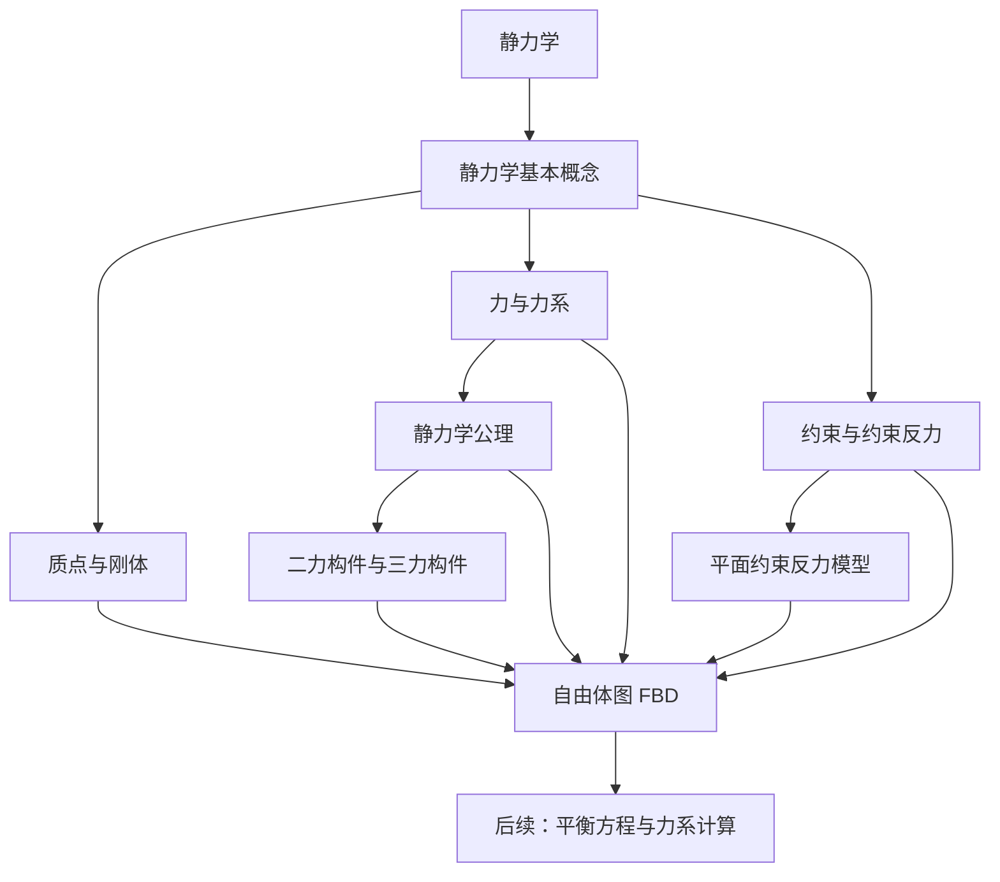

<!-- Generated by scripts/sync-obsidian-notes.mjs from Obsidian Publish. Do not edit by hand. -->

## 静力学知识图谱

> **Info**
> 本页只描述**已经建立并正在学习的 Phase 1 知识网络**。当前共 10 个 Markdown 文件：1 个领域入口（[静力学](/notes/statics/)）、1 个关系视图（本页）和 8 个已成熟知识节点。未来课程主题先作为路线图中的普通文本存在，学到后再创建节点并接入图谱，避免产生大量空白笔记或未解析链接。

### 1. Phase 1 主图



### 2. 关系不是目录关系，而是推理关系

#### 建模链

[静力学基本概念](/notes/statics-fundamentals/) → [质点与刚体](/notes/particle-rigid-body/)

回答：**研究对象应该被抽象成什么？**

#### 受力链

[力与力系](/notes/force-systems/) + [约束与约束反力](/notes/constraints-reactions/) → [自由体图 FBD](/notes/free-body-diagrams/)

回答：**有哪些外力？被移除的约束应该替换成什么反力？**

#### 公理链

[静力学公理](/notes/statics-principles/) → [二力构件与三力构件](/notes/two-three-force-members/)

回答：**哪些力的方向无需先列完整方程就能由平衡性质确定？**

#### 约束反力链

[约束与约束反力](/notes/constraints-reactions/) → [平面约束反力模型](/notes/planar-support-reactions/) → [自由体图 FBD](/notes/free-body-diagrams/)

回答：**不同约束限制了哪些运动自由度，因此产生哪些未知反力或反力矩？**

### 3. 当前关键桥梁节点

#### [自由体图 FBD](/notes/free-body-diagrams/)

它连接“物理系统”和“数学方程”。

```text
真实结构
  ↓
选择研究对象
  ↓
识别载荷与约束
  ↓
替换约束反力
  ↓
FBD
  ↓
后续平衡方程
```

#### [二力构件与三力构件](/notes/two-three-force-members/)

它是 FBD 的“信息压缩器”：
- 二力构件可直接确定两端力的作用线；
- 三力构件在平衡时提供汇交/平行的几何约束。

### 4. 当前文件构成

- **领域入口**：[静力学](/notes/statics/)
- **关系视图**：静力学知识图谱（本页）
- **成熟知识节点**：
  - [静力学基本概念](/notes/statics-fundamentals/)
  - [质点与刚体](/notes/particle-rigid-body/)
  - [力与力系](/notes/force-systems/)
  - [静力学公理](/notes/statics-principles/)
  - [约束与约束反力](/notes/constraints-reactions/)
  - [平面约束反力模型](/notes/planar-support-reactions/)
  - [二力构件与三力构件](/notes/two-three-force-members/)
  - [自由体图 FBD](/notes/free-body-diagrams/)
