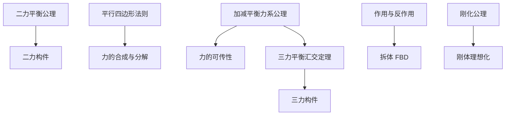

<!-- Generated by scripts/sync-obsidian-notes.mjs from Obsidian Publish. Do not edit by hand. -->

## 静力学公理 Axioms of Statics

> **Summary**
> 这些公理不是孤立背诵点，而是后续判断力的方向、等效移动、作用—反作用和刚体理想化的逻辑基础。

### 1. 二力平衡公理 Two-Force Principle

一个刚体只受两个力作用时，要使其平衡，这两个力必须：

- 大小相等；
- 方向相反；
- 作用在同一直线上。

这既是“必要”也是“充分”条件。

它直接导出 [二力构件](/notes/two-three-force-members/) 的判断规则。

### 2. 力的平行四边形法则 Parallelogram Law

两个汇交力可以按照平行四边形法则合成为一个合力；反过来也可以把一个力沿两个指定方向分解。

当前阶段只掌握几何含义。向量与分量计算将在下一阶段系统展开。

### 3. 加减平衡力系公理

在作用于刚体的某个力系上，加入或减去一个**平衡力系**，不会改变原力系对刚体的外效应。

这一公理支撑两个重要推论。

#### 3.1 力的可传性 Principle of Transmissibility

对刚体而言，力可以沿自己的**作用线**移动，而不改变其对刚体的外效应。

> **Warning**
> “沿作用线移动”不等于“可以任意平移到另一条平行作用线”。后者会改变转动效应，必须在后续用力偶补偿。

#### 3.2 三力平衡汇交定理

若刚体在三个力作用下平衡，且三个力不全平行，则三个力的作用线必须共面并汇交于一点。

Hibbeler 将同一性质表述为：三力构件平衡时，三个力要么构成汇交力系，要么全部平行。

这将用于 [二力构件与三力构件](/notes/two-three-force-members/)。

### 4. 作用力与反作用力定律 Law of Action and Reaction

两个相互作用物体之间的作用力与反作用力：

- 大小相等；
- 方向相反；
- 共线；
- **分别作用在两个不同物体上**。

> **Danger: 不要与二力平衡混淆**
> 二力平衡：两个力作用在**同一个研究对象**上。\
> 作用—反作用：两个力分别作用在**不同物体**上。

### 5. 刚化公理 Principle of Rigidification

课程中的表述是：如果一个变形体在某力系作用下已经处于平衡，把它理想化为刚体后，其平衡状态不会被破坏。

它提供了从真实可变形结构过渡到刚体静力学模型的依据之一。

> **Note**
> 这是一个单向判断：真实变形体已经平衡 ⇒ 刚化后仍满足平衡。刚体满足平衡条件，并不自动保证真实变形体在强度、刚度或稳定性方面安全。

### 6. 公理之间的关系

### 7. 知识拓扑 (Knowledge Topology)

- **前置**：[静力学基本概念](/notes/statics-fundamentals/)、[力与力系](/notes/force-systems/)、[质点与刚体](/notes/particle-rigid-body/)
- **直接应用**：[二力构件与三力构件](/notes/two-three-force-members/)
- **约束拆除后的相互作用**：[约束与约束反力](/notes/constraints-reactions/)
- **最终落地**：[自由体图 FBD](/notes/free-body-diagrams/)

### 8. 自测

- [ ] 二力平衡与作用—反作用有什么本质区别？
- [ ] “力可以在刚体上任意移动”这句话为什么错？
- [ ] 三个不平行力使刚体平衡时，作用线满足什么几何条件？
- [ ] 刚化公理为什么不能替代材料力学中的强度/变形分析？

### 9. 来源与核验

- 课程 PPT：1.2 Principles of Statics 4–19，包含二力平衡、公力平行四边形、加减平衡力系、可传性、三力平衡汇交、作用与反作用、刚化公理。
- Hibbeler, *Engineering Mechanics: Statics*, 13th ed., Ch. 5 §5.4：二力与三力构件的平衡几何条件与课程表述一致，并明确给出三力全平行的特殊情形。
