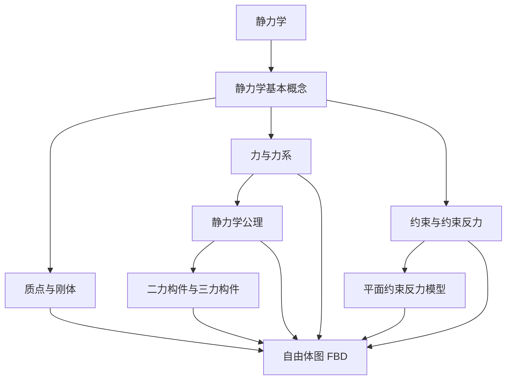

<!-- Generated by scripts/sync-obsidian-notes.mjs from Obsidian Publish. Do not edit by hand. -->

## 静力学 Statics

> **Summary: 一句话定义**
> 静力学研究物体在力系作用下的**平衡规律**，以及为建立平衡条件而进行的受力分析和力系等效处理。

### 1. 静力学在工程力学中的位置

工程力学中的刚体力学通常分为静力学与动力学：

- **Statics 静力学**：研究平衡状态，即物体保持静止或作匀速直线运动的情形。
- **Dynamics 动力学**：研究存在加速度时的运动及其与力的关系。

从牛顿第二定律看，静力学可理解为加速度为零的特殊情形；但工程中大量结构与机械部件的设计目标就是维持平衡，因此静力学需要单独形成一套建模与分析方法。

### 2. 静力学真正解决的三个问题

#### 2.1 物体受到什么作用？

先识别：
- 研究对象；
- 外载荷；
- 与周围物体的约束关系。

核心入口：[自由体图 FBD](/notes/free-body-diagrams/)。

#### 2.2 这些力之间是什么关系？

需要理解 [力与力系](/notes/force-systems/)，并判断力系属于平面/空间、汇交/平行/一般等类型。

#### 2.3 什么条件下保持平衡？

当前阶段先建立“平衡 = 所有外部作用互相抵消”的物理概念。正式的质点/刚体平衡方程将在后续阶段单独建立知识节点。

### 3. 当前知识主干

### 4. 当前阶段的解题主线

**实际对象 → 力学理想化 → 识别力与约束 → 去除约束并代以反力 → 画 FBD → 为平衡方程做准备。**

> **Important**
> 现阶段最优先掌握的不是“记公式”，而是把一张真实结构图稳定地转换成正确的自由体图。

### 5. 知识拓扑 (Knowledge Topology)

- **关系视图**：[静力学知识图谱](/notes/statics-knowledge-map/)
- **基础入口**：[静力学基本概念](/notes/statics-fundamentals/)
- **研究对象模型**：[质点与刚体](/notes/particle-rigid-body/)
- **外部作用**：[力与力系](/notes/force-systems/)
- **基本规则**：[静力学公理](/notes/statics-principles/)
- **约束建模**：[约束与约束反力](/notes/constraints-reactions/)、[平面约束反力模型](/notes/planar-support-reactions/)
- **特殊快速判断**：[二力构件与三力构件](/notes/two-three-force-members/)
- **解题核心接口**：[自由体图 FBD](/notes/free-body-diagrams/)

### 6. 下一阶段

完成当前 FBD Gate 后，知识网络将继续扩展到：力的分解与投影、汇交力系、质点平衡、力矩、力偶与力系简化。

### 7. 来源与核验

- 课程 PPT《ENGINEERING MECHANICS (Ⅰ) — STATICS》：Introduction-statics 2、8–28；课程将静力学定义为研究受力分析、力系等效/简化与平衡条件的学科。
- R. C. Hibbeler, *Engineering Mechanics: Statics*, 13th ed., Ch. 1 §1.1–1.2：将 statics 定义为研究处于静止或匀速状态物体的平衡，并给出粒子、刚体等理想化模型。
